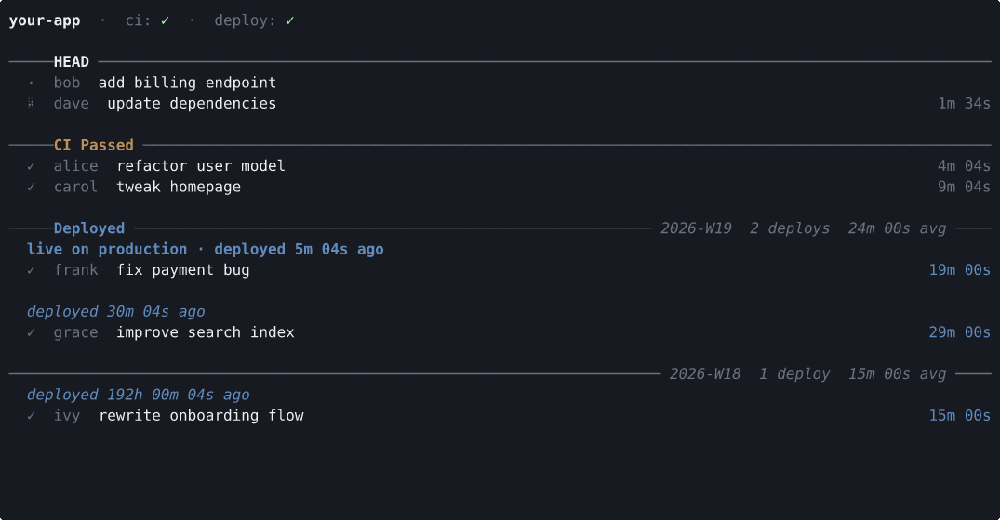

<p align="center">
  <picture>
    <source media="(prefers-color-scheme: dark)" srcset="assets/logo-dark.svg">
    
  </picture>
</p>

<p align="center"><strong>Live pipeline status for trunk-based development, in your terminal.</strong></p>

[](https://cdn.jsdelivr.net/gh/ezcdlabs/clarity@main/assets/dashboard.mp4)

Clarity is the missing view of your trunk-based pipeline: a lightweight tool that presents events from your pipeline in the context of your trunk history. It compacts what you need to see into a single clear screen.

The view is a live-updating TUI, so you can sit back and watch your commits flow through your pipeline to production without leaving your terminal. You always know the state of the whole pipeline: what's green, what's flowing, what's stuck. You learn what a normal day looks like, and you naturally spot when the pipeline is misbehaving. You also get a baseline, and when lead time creeps up over the weeks you can decide to act and bring it back down.

Setup is effortless and there's no server to run: Clarity is a single Go binary that installs as a git extension and runs with `git clarity`. The one thing it needs is events. You (or your AI agent) instrument your CI with `git clarity report`, and the events live on a git ref in your own repository.

---

## Install

### With an agent (recommended)

In the repository you want to instrument, paste this into Claude Code or any coding agent:

```
onboard this repo to clarity (github.com/ezcdlabs/clarity)
```

The agent installs the binary, runs `git clarity onboard`, and follows the briefing that command prints — wiring your pipeline up and backfilling real history. See [Onboarding](docs/onboarding.md).

### macOS (Homebrew)

```sh
brew install ezcdlabs/tap/git-clarity
```

### Windows (Scoop)

```sh
scoop bucket add ezcdlabs https://github.com/ezcdlabs/scoop-bucket
scoop install git-clarity
```

### macOS / Linux (manual)

Download the latest release from [github.com/ezcdlabs/clarity/releases](https://github.com/ezcdlabs/clarity/releases), extract, and place `git-clarity` somewhere on your `$PATH`:

```sh
# adjust the platform to taste: linux_amd64, linux_arm64, darwin_amd64, darwin_arm64
VERSION=$(curl -s https://api.github.com/repos/ezcdlabs/clarity/releases/latest | sed -n 's/.*"tag_name": "v\(.*\)".*/\1/p')
curl -sSL "https://github.com/ezcdlabs/clarity/releases/download/v${VERSION}/git-clarity_${VERSION}_linux_amd64.tar.gz" \
  | tar -xz git-clarity && sudo mv git-clarity /usr/local/bin/
```

Git will then expose it as `git clarity`.

---

## Usage

```sh
git clarity                      # watch the trunk, live (first run opens a welcome pane)
git clarity check && git push    # don't land on a red trunk
git clarity metrics              # weekly lead time and deploy frequency
```

Inside your pipelines:

```yaml
- run: git clarity report ci started
- run: ./build.sh
- run: git clarity report ci passed
- run: git clarity report deploy started
- run: ./deploy.sh && git clarity report deploy passed || git clarity report deploy failed
```

In GitHub Actions no extra secrets are needed — grant the job `permissions: contents: write` (clarity reports by pushing to a git ref) — and the [`ezcdlabs/clarity` action](docs/reporting.md#reporting-from-github-actions-ezcdlabsclarity) installs and reports in one step.

## Documentation

The [docs index](docs/README.md) has everything. Quick links:

- [Onboarding with an agent](docs/onboarding.md) — the recommended way to adopt clarity
- [Watching: `git clarity`](docs/watching.md) — the TUI, plain mode, and flags
- [Setup and configuration](docs/setup.md) — `init`, `config`, and `trust`
- [Reporting from CI](docs/reporting.md) — `git clarity report` and the GitHub Action
- [Checking before you push](docs/check.md) — `git clarity check`
- [Lead time](docs/lead-time.md) — what the numbers measure, and the three modes
- [Weekly metrics](docs/design/metrics.md) — `git clarity metrics`
- [Troubleshooting](docs/troubleshooting.md)
- [Design documents](docs/design/README.md) — the decisions behind clarity, kept as a living spec

## What this is not

- Not a CI runner — it consumes events emitted by your existing CI
- Not a build cache or artifact store
- Not a code review tool
- Not a replacement for OpenTelemetry — it's a different model (commit-centric vs trace-centric)

## Contributing

See [CONTRIBUTING.md](CONTRIBUTING.md). Coding agents: read [AGENTS.md](AGENTS.md) first.

[MIT License](LICENSE)
